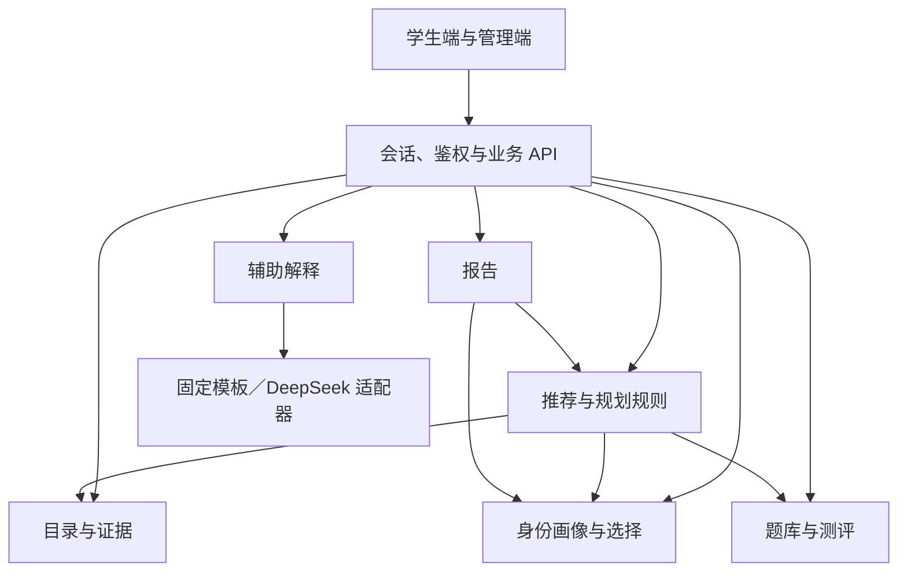

# 总体架构与演进方案

> 实施状态（2026-09-27）：本版同步完整画像驱动的具体学校与专业研究建议，区分适合度建议与目标年度资格核验。实际已实现能力、配置及上线验收边界见[实施说明](../实施说明.md)；未完成的内容建设与运营门槛不视为已交付。

版本：V0.7 · 状态：实施同步 · [文档索引](00-文档清单与需求映射.md)

本版新增院校资料三层架构与收集可靠性方案（2026-10-11）。阶段0只修订文档与测试；新增模块、读取策略和覆盖契约须在后续阶段实现并验收，现行预算保持不变。

## 1. 目标与方案边界

面向全国不同本科背景的考研用户，以注册登录、画像、可选测评、专业结论、全国目录与年度院校项目比较、分数规划构成闭环。国家学科专业目录覆盖全部门类；年度招生项目的真实覆盖见 D-01，不以少量示例代表全国院校。专业课、持续补测和复杂主观题分析按增强功能评审，不改变联合推荐的入口条件。

建议采用模块化单体：一个后端应用内划分领域模块，前端沿用 React/TypeScript，关系型数据库保存业务记录，受控文件存储保存来源原件和报告。TypeScript 后端、PostgreSQL 为建议选型，框架及部署方案在 [08 的 D-11](08-变更与扩展约定.md)决定。模块接口先明确，出现实际容量或团队边界需求后再拆服务。

## 2. Demo 历史基线与实施边界

下表保留最初 Demo 的迁移依据；目前正式入口已使用 Node.js 服务端、SQLite、账号会话及独立研究模块，实际范围见实施说明，不能把历史基线当作当前未实现状态。

| Demo 历史状态 | 迁移约束 |
| --- | --- |
| React 19、TypeScript、Vite 7，hash 页面切换，无业务后端或模型链路。 | 保留已验证交互，把页面状态、数据访问与业务计算分层；路由升级由实际需求决定。 |
| `data.ts`、`programs.ts` 为模拟项目与固定推荐，`School` 混合学校和项目字段。 | 模拟数据仅作 Demo 或测试夹具；正式接口使用 02 的年度项目模型，页面通过展示适配层接收。 |
| `assessmentQuestions.ts` 共 20 道示例题，答案随前端打包；当前界面无难度选择。 | 正式题库与答案存服务端；提交前接口不含答案。扩容与分层按 06 建设。 |
| 画像、测评、收藏、任务和后台示例存浏览器；城市为 391 项静态快照。 | 正式记录由服务端管理，浏览器只保留必要草稿；Demo 数据不自动上传，旧六题测评不迁为新版结果。 |
| 后台审核、纠错和 Markdown 报告是本地交互演示。 | 后续接入权限、工单、发布快照及报告作业，不能以界面存在代替能力完成。 |

当前测试覆盖正式应用、领域与HTTP契约，以及独立的旧Demo回归；文档测试验证结构与追踪。自动测试不能替代真实招生资料、正式题库与模型业务质量的审核。

## 3. 模块职责与数据归属

新增账号模块 `server/auth` 统一密码校验、会话旋转、身份和角色；领域数据继续归属于稳定 subjectId。全国目录与专业结论模块 `server/disciplines` 从 `knowledge/disciplines` 读取可追溯快照，不依赖当前已收录院校才能出现专业。`shared/discipline-matching` 只处理全国类别与项目代码、学位的对应，前后端共用，禁止跨学位或同名前缀误匹配。

学生页面仅挂载学习工作台与悬浮助手；管理员登录后单独挂载管理工作台。公共表单/请求/公式组件复用，模型接入放 `server/explanation`，不在页面散落供应商逻辑。

研究内部按具体变化拆分：

- `research-planning.ts` 负责完整画像、当前可用字段引用与全国方向。
- `research-search.ts` 负责有界候选发现、真实域名补证及跨方向/学校来源选取。
- `research-evidence.ts` 负责具体项目条件和原文保留；`research-constraints.ts` 负责学费/城市证据及独立约束检查。
- 服务端 `demand-match-v1` 固定规则分层，模型只提供解释，不能改变层级。
- `research-generation.ts` 负责同预算内有界校验修复及一次确认临时HTTP重试；`research.ts` 负责报告协调及核验，路由负责持久任务。

检索策略复用同一搜索适配器和总预算，不自行发无限循环请求。正式目录、公共院校资料库与实时检索分层管理，现有 `research_public_sources` 保存公共原文，不等于另一套审核发布的正式目录。

三层资料的数据归属：正式目录由目录模块审核发布；公共院校资料库只保存公开原文与未经审核的结构化事实；实时检索只补库中缺口。研究不能把网络材料自动发布到 `knowledge/catalog`，公共资料不保存个人画像、查询文本或模型建议。

共享数据库不表示任意模块可修改彼此的数据。模块通过自己的接口写入所属记录；推荐读取其他模块固定版本的输出，不回写资格原文或测评结果。

| 模块 | 拥有并写入的数据 | 接口与依赖 |
| --- | --- | --- |
| 身份与画像 | 稳定主体、画像版本、城市偏好 | 提供当前主体和画像快照；账户扩展通过主体绑定实现。 |
| 选择与规划 | 收藏、屏蔽、确认专业、目标、计划及任务状态 | 提供选择快照；调用目录和规划规则核验目标，维护用户任务进度。 |
| 目录与证据 | 招生项目、科目、历史分数、城市、就业/政策/评价事实、目录发布 | 对外提供已发布事实快照及可用性；内部负责导入、审核和纠错。 |
| 院校种子库 | `knowledge/schools/registry.json` 中458校、31个省级行政区、147所第二轮双一流的全国官网和招生网址线索 | 阶段3已实现 server/schools 启动校验与 discoveryOnly: true 查询；资料负责人维护、部署方每月及发布前免费复核，不把种子当招生事实；D-13、T-28。 |
| 公共院校资料库 | 已有公共原文表与阶段4实现的结构化 `ProgramFact`、来源及获取时间 | `research-library.ts` 拥有读写接口；研究先召回，再定向补缺，实时读取和预抓取通过该接口写入，始终 `verified:false`；T-29。 |
| 预抓取脚本 | `scripts/prefetch-schools.mjs` 的公开读取任务与诊断（阶段4已实现） | 部署方按城市/学科从种子出发发现目录、简章和学费页；不调用付费搜索，遵守 robots.txt，每主机串行、间隔≥1秒；D-14。 |
| 题库与测评 | 审核题库、固定题集、作答、判分和诊断版本 | 按范围组卷、保存草稿、主动提交；读取确认专业，提供适用诊断。 |
| 推荐与规划规则 | 规则包、推荐运行、规划建议计算依据 | 读取画像、选择、目录、诊断，执行确定性计算；返回建议供规划模块保存。 |
| 报告 | 报告快照、生成任务与文件引用 | 读取固定推荐运行、计划版本，生成 Markdown；不触发隐式重算。 |
| 辅助解释与独立研究 | 模型配置、调用计量、受限缓存、研究方向及校专业建议 | 固定解释读取已有依据；研究从全国目录及完整画像规划方向，再读取实际学校资料形成条件性建议；不能写正式资格、评分或年度榜单排序。 |

管理端是各模块的受权入口，不维护另一套真实数据。删除协调流程按 [05](05-安全运维与验证.md)通知数据所属模块清理；审计由统一基础设施追加保存。

箭头表示调用或读取依赖。固定解释接收业务方构造的证据包，独立研究另通过受控搜索与网页读取适配器收集证据；两者均不回写正式推荐规则。研究持久任务由路由协调，模型与网络工作在数据库事务外，阶段及结果按版本检查后保存。模块不得循环调用或跨归属修改数据。

## 4. 主流程与一致性边界

1. 资料先入草稿，经来源、身份、年份、范围和人工审核，原子发布不可变目录或题库版本；状态由 [02](02-数据模型与可信数据.md)定义。
2. 保存画像及选择分别产生版本。创建测评固定题集，提交后产生独立诊断；公共课、专业课、补测通过 `assessmentRefs[]` 按适用性组合引用。
3. 推荐固定画像、选择、目录、规则及诊断版本，生成 `recommendationRunId`。同样输入和版本的业务结果必须一致；模型措辞不参与排序。
4. 收藏和目标使用完整项目 ID。规划引用固定项目修订和规则；报告引用指定推荐运行与计划版本，不读取生成中途变化的最新值。
5. 条件或公开资料更新时，旧结果标记需刷新；重算产生新运行和报告。用户历史不会被后台更新悄然覆盖；紧急资料撤回立即阻止其继续作为有效依据。

公开目录缓存按版本共享；个人计算或解释缓存按主体、输入版本和用途隔离，不能跨用户共享，随个人资料删除清理。缓存不充当事实来源。故障、作业一致性和发布兼容门槛统一见 [05](05-安全运维与验证.md)、[08](08-变更与扩展约定.md)。

## 5. 演进顺序与退出条件

| 阶段 | 交付边界 | 退出条件 |
| --- | --- | --- |
| A. 契约与资料基座 | 定义实体、来源、权限和发布；准备试点资料与审核题库 | D-01、D-02、D-03、D-11 解决对应阻塞；持久化和删除可审查。 |
| B. 规则闭环 | 画像、公共课、资格、联合排序、分数规划、比较和报告 | D-04、D-06、D-07、D-12 中主链路规则已评审；未知与不适用处理有测试。 |
| C. 交互接入与上线验证 | 迁移页面、管理端、运维及验收 | 05 首版验收通过；无模拟数据混入、越权、错误发布或删除恢复漏洞。 |
| 本轮院校资料修复（阶段0～7） | 阶段0文档；阶段1读取可靠性；阶段2校验与绑定；阶段3种子库；阶段4资料库与预抓取；阶段5预算与模型输入；阶段6页面展示；阶段7真实验证 | R-32～R-38 与 T-26～T-32逐项验收；阶段0～4已完成，D-13、D-14与D-15已确定；阶段0不实现业务代码。 |
| 后续增强 | 专业课、持续补测、模型辅助、更多数据或账户能力 | 按 08 评审；模型另满足 07 和 D-08，不阻断固定解析方案。 |

全国种子查询按主城市和跨城校区提示产生线索，每城市最多12校，双一流优先、校名稳定排序。已观察的学校专业来源优先读取，直接种子导航最多6次；不会借用意向城市恢复槽位。学校级搜索使用具体注册域名 includeDomains，18/24次搜索与24次总读取及单校上限保持不变。维护流程见 [种子库说明](../../knowledge/schools/README.md)。

A～C 都是首版上线前工作，联合推荐必须在首版闭环中。该顺序描述依赖关系，不是已承诺排期。

## 6. 阶段4资料复用实现

R-35 / T-29 / D-14 已接入公共原文与 `research_program_facts`。`research-library.ts` 统一提供 queryFacts、coverageStats、load、save；事实提取复用阶段2确定性绑定和阶段3学校种子，不保存个人画像、查询文本或模型建议，始终 `verified:false`。

报告先召回公开事实和原文，再按项目字段定向补缺；来源ID、连续原文、原获取时间保留，复用建议仍通过当前画像校验。预抓取脚本从同校种子出发，遵守 robots.txt、每主机串行、间隔≥1秒、≤4主机并发和深度≤3，免费运行。研招网动态专业目录采用安全降级；本阶段没有改变搜索或读页预算。
