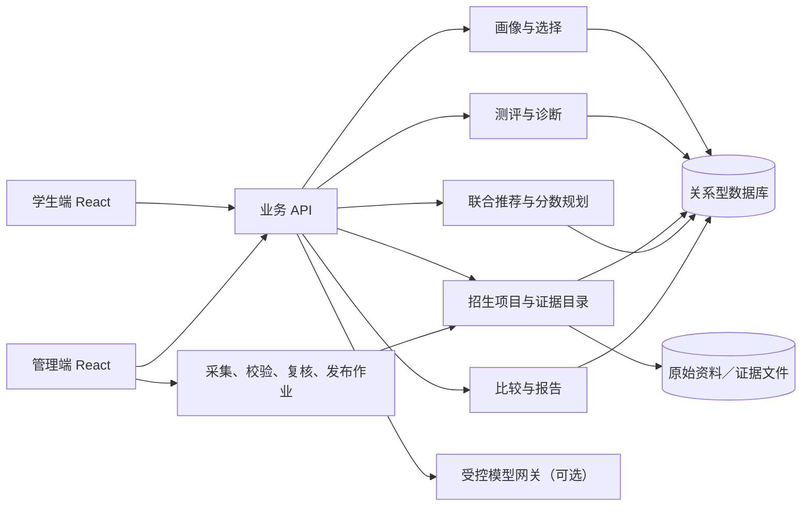

# 总体架构与演进方案

版本：V0.1 · 依据：[产品设计文档 V0.5](../产品设计文档.md) · 状态：技术设计草案

## 1. 目标与边界

首版面向产品文档限定的全日制理工科试点范围，让尚未确定专业或院校的学生完成画像、可选公共课测评、专业与院校联合推荐、双向比较、确定组合及分数规划。专业课测评是确认目标专业后的可选增强，不阻断推荐。首版覆盖的专业、院校、招生年份及官方资料清单须在开发前确定并在产品中展示；资料不完整的项目不能伪装为已核验推荐。

系统负责提供有来源、可复算、可解释的决策支持。它不把少量示例题换算为考研分数，不给未经验证的精确录取概率，也不把“冲刺／匹配／相对稳妥”解释为录取保证。考试科目和报考资格以**具体招生项目及年份**为准，学硕、专硕不能被写死为固定科目组合。

## 2. 当前仓库基线与迁移边界

| 现状 | 首版处理方式 |
| --- | --- |
| React 19 + TypeScript + Vite 7 单页应用；`App.tsx` 以 hash 切页，承载探索、收藏、目标、规划和报告。 | 保留页面与已验证的响应式、键盘交互；将数据获取、业务状态和页面展示分层，逐步拆开集中在 `App.tsx` 的逻辑。路由方式是否升级由实际导航需求决定。 |
| `data.ts`、`programs.ts` 内置模拟项目、专业方向、分数、名额、适配值和文案；当前推荐是固定集合上的过滤与排序。 | 仅保留为 Demo / 测试夹具。上线页面从已发布的项目目录与推荐接口获取数据，不把模拟项目混入真实数据。画像、测评和偏好的变化由服务端规则生成新结果与变更理由。 |
| `types.ts` 的 `School` 把院校、学院、项目、年份、分数、评价和展示字段压在一个对象中。 | 建立分离的领域模型与带版本的 API 契约；保留组件层所需的展示适配器，避免让旧 `School` 结构成为数据库模型。 |
| 画像、收藏、排除、目标、任务以及后台记录存于 `localStorage`；测评草稿独立使用 v2 键和题目 ID。 | 浏览器继续保存未提交表单草稿；需要持久化的数据改由服务端保存。迁移时不自动上传旧 Demo 画像或模拟收藏，须由用户确认；旧 6 题缓存和演示记录不得作为生产测评、管理数据。 |
| `AssessmentView.tsx` 已实现模块选择、每科 5 题、自动切题、末题主动提交、版本隔离；`CityPicker.tsx` 已实现搜索、多选和浮层交互。 | 复用交互与端到端测试。正式题目、答案、适用专业和题库版本从已复核题库读取；城市目录仍可做前端搜索索引，但需记录快照版本。 |
| `Flows.tsx` 的管理页仅模拟记录编辑与复核；`SchoolDetail.tsx` 的纠错为浏览器草稿；报告在浏览器拼接 Markdown。 | 管理页接入权限、审核和发布流程；纠错进入待处理工单；报告从同一份推荐快照与证据生成，标注生成时间和数据版本。 |

现有 `tests/demo.spec.ts` 可继续作为交互回归基线，`tests/test_product_document.py` 只验证产品文档结构。两者不能证明真实招生资料、推荐规则或权限安全正确。

## 3. 建议的首版系统形态

采用**单一后端应用内按领域分模块**的方案。试点数据量与团队规模尚未确定，先避免独立微服务带来的部署与一致性成本；模块边界和接口保持清晰，后续按瓶颈拆分。前端延用 React/Vite/TypeScript。后端优先采用 TypeScript 服务，以便共用契约类型；具体框架在接口原型和团队技术栈确认后定稿。持久化使用关系型数据库（建议 PostgreSQL）；原始资料、脱敏证据与报告文件使用对象存储；后台采集与复核采用异步作业。缓存只加速公开目录查询，不作为事实来源。

### 3.1 主要职责

| 模块 | 关键职责 |
| --- | --- |
| 学生端 | 画像与偏好、城市选择、测评、专业／院校双入口探索、收藏／排除／比较、目标与报告；展示证据、更新时间、缺失状态及反馈入口。 |
| 画像与选择 | 保存草稿、偏好权重、已屏蔽项、收藏项目和目标组合；按用户请求删除关联个人数据与草稿。首次使用可保持匿名会话，是否提供账号和跨设备同步另行决定。 |
| 测评与诊断 | 按已选公共课模块及题库版本发题、保存答案、客观题判分、产出知识点级诊断和“证据不足”状态；专业课按已确认目标专业及适用项目选用，不复用不适用的旧结果。 |
| 招生与证据目录 | 以“学校＋学院＋专业／方向＋学位类型＋学习方式＋招生年份”为项目身份；保存实际考试科目、报考资格、名额口径、历年成绩、就业与政策资料，以及来源、适用范围、抓取和人工核验时间。 |
| 联合推荐与分数规划 | 先做报考资格和资料状态筛选，再计算专业与项目适配、风险和偏好排序；返回最多十个项目及关联专业方向、排除原因、规则／数据版本。分数规划分别展示历史门槛、建议备考目标和当前待评估能力，并检查总分、单科及复试条件。 |
| 管理端 | 资料导入、差异检查、题库维护、评价证据去重与脱敏、双人或指定角色复核、发布／撤回、纠错处理和操作审计。未发布内容不能进入学生端推荐。 |
| 模型网关 | 仅基于已提供的资料和确定性计算结果进行补问、解释、报告整理或辅助分析解题过程；输出要能追溯到输入证据。资格筛选、客观题判分、排序和阈值判断由规则服务完成。 |

### 3.2 关键数据流

1. **资料发布**：采集官方文件与可核实材料 → 提取结构化字段 → 校验年份、项目身份和口径 → 人工复核 → 发布不可变目录版本。无法确认的字段保留“未知／待核验”，不从相邻年份推断。
2. **画像与测评**：学生填写或修改画像 → 选择公共课模块 → 按题库版本保存答案和结果。跳过测评仍能请求推荐，结果标记能力证据不足。
3. **联合推荐**：提交画像、偏好、已屏蔽项、目标年份和可用诊断 → 资格规则筛选项目 → 对候选专业和项目计算适配维度 → 稳定排序、生成原因与风险 → 返回结果快照。修改专业或院校偏好时重算两侧候选，保留前后快照供解释变化。
4. **比较与规划**：学生收藏、排除和确定完整项目组合 → 基于同一目录与推荐快照生成比较、目标分数和报告；考试科目或项目口径变化时提示不可直接横向比较。
5. **反馈闭环**：用户提交纠错或评价线索 → 管理端核对原始证据、适用范围、独立来源和处理状态 → 仅经复核的风险影响展示或排序 → 新目录版本发布后重算受影响结果，并提示旧报告可能过期。

每次推荐响应至少带 `catalogVersion`、`ruleVersion`、`assessmentVersion`、生成时间、输入摘要、候选项目的证据状态与原因码。排序使用明确的平分规则和稳定项目 ID；相同输入与版本应得到相同筛选、分数及顺序。大模型文案不参与这一确定性约束。

## 4. 运行、部署与降级

- **部署**：学生端静态资源部署到静态站点／CDN；业务 API、管理端 API 和后台作业部署在受控服务环境；数据库与文件存储分别备份。学生端、管理端使用独立入口与权限策略。开发、预发布、生产环境分离，模拟夹具只允许在开发／自动化测试环境出现。
- **发布**：目录和规则采用显式版本；先验证数据完整性与回归样例，再发布新版本。后端保留旧快照的可追溯信息，报告保存生成时的来源与版本。规则、目录、前端可分别回滚，但回滚后需检查版本兼容。
- **模型不可用**：查询、资格筛选、排序、测评客观题评分和比较继续运行；解释切换到规则模板并明确资料不足，不返回模型编造的依据。
- **部分资料缺失或过期**：项目可进入“待核验”列表或降低展示优先级，关键报考条件缺失时不列入可报考推荐前十；显示缺失字段、来源和核验时间，不以空值表示零或负面结论。
- **后台作业或外部来源不可用**：继续服务最后一个已发布且标明日期的目录版本；停止发布新资料，记录告警。若目标年份关键信息已失效，暂停该项目的推荐资格。
- **业务 API 不可用**：前端保留当前浏览器草稿和已加载页面；停止生成新推荐与报告并提示重试。不得将 Demo 静态项目作为看似真实的备用推荐。

按功能记录请求成功率、推荐耗时、数据版本、资料过期量、纠错处理时长和模型失败率；业务日志避免记录完整画像、答案原文或未脱敏评价证据。管理操作与版本发布须可审计。

## 5. 分阶段演进与上线门槛

| 阶段 | 可交付工作 | 退出条件 |
| --- | --- | --- |
| A. 契约与资料基座 | 定义项目身份、来源状态、版本字段和 API 契约；搭建资料导入、复核、发布与纠错流程。 | 试点专业及院校清单确定；目标年份资料可追溯，关键报考字段通过人工复核。 |
| B. 规则闭环 | 实现画像、公共课测评、资格筛选、专业与院校双向排序、原因码、分数口径检查及收藏／比较／报告。 | 未确定专业或院校也可获得有依据的联合结果；相同输入与版本结果稳定，偏好改变可解释；缺失数据处理和降级验证通过。 |
| C. 交互迁移与验收 | 将现有页面改接真实契约，保留城市选择、测评和弹窗交互；完成权限、隐私、性能、移动端及回归验证。 | 产品文档第 7 节首版验收全部满足；模拟数据不进入生产；管理端发布及回滚演练通过。 |

A～C 均属于**首版上线前**工作，不能把阶段 B 的专业与院校联合推荐推迟到上线后。专业课测评、多学科覆盖、持续复测、招生变动提醒和复杂主观题批改按产品文档列为后续增强。

## 6. 关键决策与待定点

| 事项 | 当前建议／待确认内容 |
| --- | --- |
| 应用形态 | 首版使用模块化单体后端与关系型数据库；明确模块接口后再评估拆分服务。 |
| 推荐机制 | 可审查的资格规则 + 分维度加权排序 + 模板解释先行；模型只增强语言表达，不能提供未经核验的学校事实或录取概率。权重、平分规则及“严重风险默认移出前十”的审核标准需专项设计。 |
| 数据覆盖 | 开发前由产品与资料团队确定具体专业、院校、年份、招生类型及最低可用证据标准；覆盖范围决定数据工作量和推荐质量。 |
| 身份与保存 | 默认不以填写真实姓名作为使用前提；匿名会话、跨设备同步、账号绑定和数据保留期限需结合运营方式确定。删除必须覆盖服务端个人记录与本地草稿。 |
| 测评效度 | 首版 5 题／科只能作基础诊断；正式题库、难度、知识点映射、评分与复测规则需独立复核。专业课测评是否纳入首版取决于确认后的资源，不影响主流程。 |
| 分数及风险 | 历史成绩必须按统考、推免、专项、学习方式和考试科目等口径核对；建议目标的计算规则、单科线处理、评价分级和证据独立性须经业务评审。 |
| 技术选型 | 后端框架、对象存储、作业队列、部署平台、身份服务及模型供应商在接口原型、团队能力、成本和数据要求明确后定稿；首版不依赖特定模型服务才能运行。 |

本轮配套文档分别覆盖[数据模型与可信数据](02-数据模型与可信数据.md)、[联合推荐测评与分数规划](03-联合推荐测评与分数规划.md)、[接口与前端交互](04-接口与前端交互.md)和[安全运维与验证](05-安全运维与验证.md)。进入开发前仍需对照产品文档 V0.5 的验收条目评审这些规则和样例，并解决文档清单中的待确认决策。
