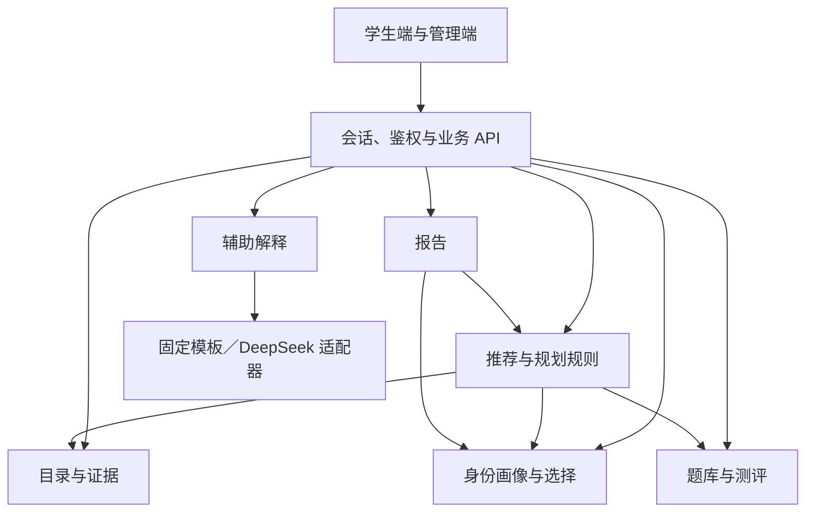

# 总体架构与演进方案

> 实施状态（2026-09-27）：本版同步兴趣选择、题干与交卷回顾、独立目标保存及联网研究报告需求。实际已实现能力、配置及上线验收边界见[实施说明](../实施说明.md)；未完成的内容建设与运营门槛不视为已交付。

版本：V0.4 · 状态：实施同步 · [文档索引](00-文档清单与需求映射.md)

## 1. 目标与方案边界

面向全国不同本科背景的考研用户，以注册登录、画像、可选测评、专业结论、全国目录与年度院校项目比较、分数规划构成闭环。国家学科专业目录覆盖全部门类；年度招生项目的真实覆盖见 D-01，不以少量示例代表全国院校。专业课、持续补测和复杂主观题分析按增强功能评审，不改变联合推荐的入口条件。

建议采用模块化单体：一个后端应用内划分领域模块，前端沿用 React/TypeScript，关系型数据库保存业务记录，受控文件存储保存来源原件和报告。TypeScript 后端、PostgreSQL 为建议选型，框架及部署方案在 [08 的 D-11](08-变更与扩展约定.md)决定。模块接口先明确，出现实际容量或团队边界需求后再拆服务。

## 2. 当前仓库与迁移边界

| 当前状态 | 后续迁移要求 |
| --- | --- |
| React 19、TypeScript、Vite 7，hash 页面切换，无业务后端或模型链路。 | 保留已验证交互，把页面状态、数据访问与业务计算分层；路由升级由实际需求决定。 |
| `data.ts`、`programs.ts` 为模拟项目与固定推荐，`School` 混合学校和项目字段。 | 模拟数据仅作 Demo 或测试夹具；正式接口使用 02 的年度项目模型，页面通过展示适配层接收。 |
| `assessmentQuestions.ts` 共 20 道示例题，答案随前端打包；当前界面无难度选择。 | 正式题库与答案存服务端；提交前接口不含答案。扩容与分层按 06 建设。 |
| 画像、测评、收藏、任务和后台示例存浏览器；城市为 391 项静态快照。 | 正式记录由服务端管理，浏览器只保留必要草稿；Demo 数据不自动上传，旧六题测评不迁为新版结果。 |
| 后台审核、纠错和 Markdown 报告是本地交互演示。 | 后续接入权限、工单、发布快照及报告作业，不能以界面存在代替能力完成。 |

现有端到端测试证明 Demo 交互，文档测试证明结构与追踪；两者均不证明真实招生数据或未来后端正确。

## 3. 模块职责与数据归属

新增账号模块 `server/auth` 统一密码校验、会话旋转、身份和角色；领域数据继续归属于稳定 subjectId。全国目录与专业结论模块 `server/disciplines` 从 `knowledge/disciplines` 读取可追溯快照，不依赖当前已收录院校才能出现专业。`shared/discipline-matching` 只处理全国类别与项目代码、学位的对应，前后端共用，禁止跨学位或同名前缀误匹配。

学生页面仅挂载学习工作台与悬浮助手；管理员登录后单独挂载管理工作台。公共表单/请求/公式组件复用，模型接入放 `server/explanation`，不在页面散落供应商逻辑。

共享数据库不表示任意模块可修改彼此的数据。模块通过自己的接口写入所属记录；推荐读取其他模块固定版本的输出，不回写资格原文或测评结果。

| 模块 | 拥有并写入的数据 | 接口与依赖 |
| --- | --- | --- |
| 身份与画像 | 稳定主体、画像版本、城市偏好 | 提供当前主体和画像快照；账户扩展通过主体绑定实现。 |
| 选择与规划 | 收藏、屏蔽、确认专业、目标、计划及任务状态 | 提供选择快照；调用目录和规划规则核验目标，维护用户任务进度。 |
| 目录与证据 | 招生项目、科目、历史分数、城市、就业/政策/评价事实、目录发布 | 对外提供已发布事实快照及可用性；内部负责导入、审核和纠错。 |
| 题库与测评 | 审核题库、固定题集、作答、判分和诊断版本 | 按范围组卷、保存草稿、主动提交；读取确认专业，提供适用诊断。 |
| 推荐与规划规则 | 规则包、推荐运行、规划建议计算依据 | 读取画像、选择、目录、诊断，执行确定性计算；返回建议供规划模块保存。 |
| 报告 | 报告快照、生成任务与文件引用 | 读取固定推荐运行、计划版本，生成 Markdown；不触发隐式重算。 |
| 辅助解释 | 模型配置、调用计量、受限解释缓存 | 接收最小证据包，通过固定模板或 DeepSeek 适配器返回文字；不能写资格、评分或排序。 |

管理端是各模块的受权入口，不维护另一套真实数据。删除协调流程按 [05](05-安全运维与验证.md)通知数据所属模块清理；审计由统一基础设施追加保存。

箭头表示调用或读取依赖。辅助解释只接收业务方构造的证据包，不反向驱动推荐；模块不得循环调用。跨模块流程由应用层协调，持久状态仍由所属模块管理。

## 4. 主流程与一致性边界

1. 资料先入草稿，经来源、身份、年份、范围和人工审核，原子发布不可变目录或题库版本；状态由 [02](02-数据模型与可信数据.md)定义。
2. 保存画像及选择分别产生版本。创建测评固定题集，提交后产生独立诊断；公共课、专业课、补测通过 `assessmentRefs[]` 按适用性组合引用。
3. 推荐固定画像、选择、目录、规则及诊断版本，生成 `recommendationRunId`。同样输入和版本的业务结果必须一致；模型措辞不参与排序。
4. 收藏和目标使用完整项目 ID。规划引用固定项目修订和规则；报告引用指定推荐运行与计划版本，不读取生成中途变化的最新值。
5. 条件或公开资料更新时，旧结果标记需刷新；重算产生新运行和报告。用户历史不会被后台更新悄然覆盖；紧急资料撤回立即阻止其继续作为有效依据。

公开目录缓存按版本共享；个人计算或解释缓存按主体、输入版本和用途隔离，不能跨用户共享，随个人资料删除清理。缓存不充当事实来源。故障、作业一致性和发布兼容门槛统一见 [05](05-安全运维与验证.md)、[08](08-变更与扩展约定.md)。

## 5. 演进顺序与退出条件

| 阶段 | 交付边界 | 退出条件 |
| --- | --- | --- |
| A. 契约与资料基座 | 定义实体、来源、权限和发布；准备试点资料与审核题库 | D-01、D-02、D-03、D-11 解决对应阻塞；持久化和删除可审查。 |
| B. 规则闭环 | 画像、公共课、资格、联合排序、分数规划、比较和报告 | D-04、D-06、D-07、D-12 中主链路规则已评审；未知与不适用处理有测试。 |
| C. 交互接入与上线验证 | 迁移页面、管理端、运维及验收 | 05 首版验收通过；无模拟数据混入、越权、错误发布或删除恢复漏洞。 |
| 后续增强 | 专业课、持续补测、模型辅助、更多数据或账户能力 | 按 08 评审；模型另满足 07 和 D-08，不阻断固定解析方案。 |

A～C 都是首版上线前工作，联合推荐必须在首版闭环中。该顺序描述依赖关系，不是已承诺排期。
